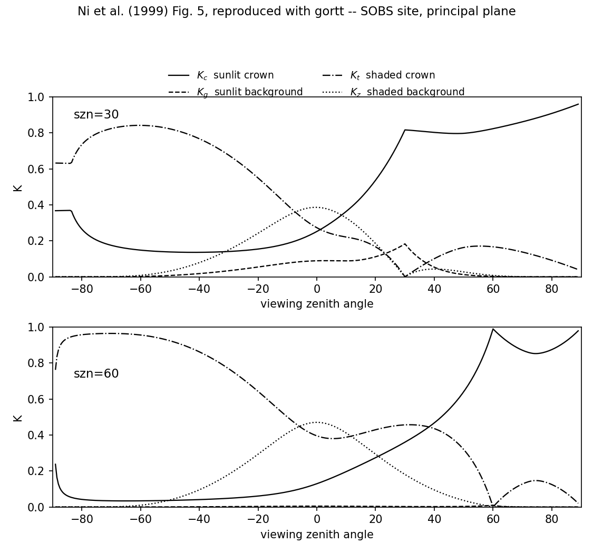

# GORT

A C implementation of the Geometric Optic Radiative Transfer model as described by Ni et al. (1999). 
Models the BRDF and LIDAR returns of forests at optical wavelengths by
calculating the viewed proportions of illuminated and shaded crown and ground,
and their reflectance factors, for randomly located ellipsoids.

Version 2.0 of the model is a tidied version of the one that was originally used as the forward operator for data assimilation experiments described by Quaife et al. (2008). It is a broadly faithful implementation of the model described by Ni et al. (1999), but coupled to models for the leaf and soil optical properties.

Version 3.0 introduces the LIDAR routines following Ni-Meister et al. (2001). These changes have been made by Claude Opus 5.

## Main features

* Calculates BRDFs for arbitrary view-illumination geometry and from 400nm to 2500nm.
* Calculates spectral albedo and absorption by the forest (e.g. fAPAR).
* Coupled to PROSPECT-D to (optionally) provide leaf optical properties.
* Soil reflectance using EOFs from Price (1990).
* Reads/writes LUTs of key intermediate variables to speed up some applications.
* Predicts full waveform lidar returns at nadir, following Ni-Meister et al. (2001).

## Example outputs

The following figure is a reproduction of Figure 5 from Ni et al. (1999) using the most recent version of the code.

## Authors

Dr Tristan Quaife & Dr Wenge Ni-Meister

With the exception of the contents of the PROSPECT-D directory all code was written by Tristan based on the equations described in Ni et al. (1999) or, in the case of the KOpen probability routines, translated directly from Wenge's code.

Information about PROSPECT authorship can be found at http://teledetection.ipgp.jussieu.fr/prosail/

From version 2.0 onward, Claude Code has been used for various tasks, the most substantial of which is the addition of LIDAR predictions (see below).

## Usage
 
usage: `gortt [options] < angles.dat > output.dat`

A list of \[options\] and brief description of the format of the angles.dat file can be found by typing:

`gortt -u`

By default GORT models the BRFs observed by a sensor viewing at the wavelengths and sun-sensor
geometry described in `angles.dat`. Scene elements (stand density, crown shape, leaf area index etc) are provided 
via the command line options.

## Example

The following example calculates the reflectance for a forest with an LAI of 4.0 at wavelengths of 450nm, 600nm and 1000nm for a view zenith of 10 degrees, solar zenith of 30 degrees and relative azimuth of 20 degrees.

`echo -en "1 4 450 600 800 1000\n10 0 30 20\n"|./gortt -LAI 4.0`

## Lidar

`-lidar` predicts the lidar waveform of the canopy instead of its reflectance. The
instrument is assumed to be at nadir, so no view-illumination geometry is needed and
nothing is read from `stdin`; the normal output is suppressed.

`./gortt -lidar -LAI 4.0`

By default this writes the per-layer profile: the total nadir gap probability `P(z)`,
its vertical derivative, the apparent foliage profile `dlogP/dz` and the canopy return
density, one row per canopy layer, with the ground return on the header line. Adding
`-lidar_waveform` instead bins the canopy and ground returns onto a uniform range grid
and convolves them with the transmitted pulse, which is what an instrument records:

`./gortt -lidar -lidar_waveform -lidar_pulse 1.0 -lidar_binsize 0.15 -nlayers 60 -LAI 4.0`

Each contribution is split linearly between the two range bins it falls between, so the
binning conserves the total returned energy and its mean height exactly, and the waveform
does not change shape with `-lidar_binsize`.

The lidar wavelength is set with `-lidar_wl` (default 1064nm) and feeds PROSPECT-D and
the Price soil model exactly as the reflectance calculation does. `-nlayers` sets the
number of canopy height layers the profile is reported on. It is a reporting grid only:
none of the quadratures in the model step with it, so the BRF does not move when it
changes.

## Numerical accuracy

The gap probabilities are the numerical core of the model, and the quadratures behind
them are independent of `-nlayers`. Three of the four are analytic over most of their
range; where one is not, the order is set by `-nquad` (default 1, already converged).
Two useful consequences:

* the between-crown gap probability at the ground has a closed form at every zenith
  angle, and `gortt` matches it to 2.8e-14;
* `gortt -W` output is byte-identical for any two values of `-nlayers`.

`figures/quadrature_convergence.py` draws the evidence for both.

## Install

I have only ever tried installing on Linux platforms. As long as you have the standard development tools installed (specifically `gcc`, `gfortran` and `make`) it should just be a case of typing `make`. Note that currently the C bindings for the PROSPECT are throwing a number of warnings. As far as I can tell these are harmless.

## References

Ni, W., Li, X., Woodcock, C. E., Caetano, M. R., & Strahler, A. H. (1999). An analytical hybrid GORT model for bidirectional reflectance over discontinuous plant canopies. IEEE Transactions on Geoscience and Remote Sensing, 37(2), 987-999.

Ni-Meister, W., Jupp, D. L. B., & Dubayah, R. (2001). Modeling lidar waveforms in heterogeneous and discrete canopies. IEEE Transactions on Geoscience and Remote Sensing, 39(9), 1943-1958.

Price, J. C. (1990). On the information content of soil reflectance spectra. Remote Sensing of Environment, 33(2), 113-121.

Quaife, T., Lewis, P., De Kauwe, M., Williams, M., Law, B. E., Disney, M., & Bowyer, P. (2008). Assimilating canopy reflectance data into an ecosystem model with an Ensemble Kalman Filter. Remote Sensing of Environment, 112(4), 1347-1364.
